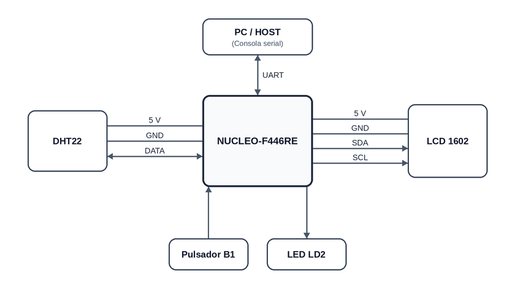
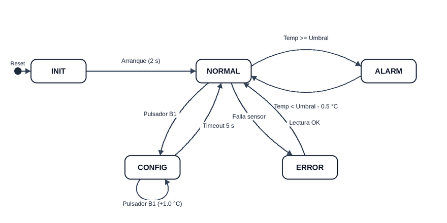

# Monitor de clima y alarma ambiental 

**Autor:** Nahuel Severini  
**Carrera:** Carrera de Especialización en Sistemas Embebidos (CESE) - FIUBA  
**Asignatura:** Programación de Microprocesadores (PdM)  
**Año / Cohorte:** 2026 - Cohorte 27Co2026  

---

## 1. Descripción del proyecto
Sistema embebido para el monitoreo en tiempo real de temperatura y humedad ambiente, con ajuste de umbral de alarma y visualización en pantalla LCD 16x2 y terminal serie.

El sistema funciona con un lazo principal cooperativo no bloqueante y máquinas de estados finitos (MEF) para el control de clima, el antirrebote del pulsador y el procesamiento de comandos por UART.

---

## 2. Diagrama en bloques
El sistema está compuesto por la placa de desarrollo y los siguientes periféricos:

---

## 3. Hardware utilizado
* **Placa de desarrollo:** NUCLEO-F446RE (microcontrolador STM32F446RE).
* **Sensor de temperatura y humedad:** DHT22 (AM2302) mediante protocolo unifilar.
* **Pantalla:** LCD 16x2 (controlador HD44780) con módulo adaptador I2C (chip PCF8574).
* **Entradas y salidas de la placa:** Pulsador de usuario B1 (PC13) y LED de estado LD2 (PA5).
* **Comunicación serie:** USART2 (115200 bps, 8N1) conectada a la PC mediante el puerto serie virtual del ST-LINK.

---

## 4. Arquitectura de software
El código está organizado en capas independientes:

* **Aplicación (`Core/Src`, `Core/Inc`):**
  * `app_climate`: MEF principal (estados INIT, NORMAL, CONFIG, ALARM, ERROR), histéresis de temperatura y manejo del umbral.
  * `app_display`: Control de refresco del LCD 16x2 (actualización inmediata ante cambios de estado y periódica para las mediciones).
  * `app_uart`: MEF de recepción carácter por carácter, procesamiento de comandos y envío periódico de telemetría.
* **Drivers de dispositivos (`Drivers/`):**
  * `dht22`: Lectura del sensor, cálculo de temperatura/humedad y verificación de checksum. El archivo `dht22_port` contiene el manejo directo del pin GPIO y los tiempos de espera.
  * `lcd`: Inicialización en modo de 4 bits y envío de comandos y caracteres al display. El archivo `lcd_port` contiene la comunicación I2C con la biblioteca HAL.
* **Capa de soporte de placa (`Drivers/BSP/`):**
  * Manejo del LED, antirrebote del pulsador B1 (MEF de 4 estados con temporización no bloqueante) y demoras en microsegundos utilizando el contador de ciclos DWT del procesador.

---

## 5. Máquina de estados principal (MEF de clima)
La lógica de control opera según el siguiente diagrama de estados:

### Comportamiento de cada estado:
* **INIT:** Inicialización del hardware y primera lectura del sensor.
* **NORMAL:** Temperatura por debajo del umbral. El LED titila lento (1 Hz).
* **ALARM:** Temperatura >= umbral configurado. El LED titila rápido (5 Hz). Cuenta con una histéresis de 0.5 °C para evitar que la alarma oscile al bajar la temperatura.
* **CONFIG:** Modificación del umbral mediante el pulsador B1 (+1 °C de forma circular entre 15 °C y 40 °C) o por comandos serie. El LED queda encendido fijo. Si no se presiona nada durante 5 segundos, vuelve al modo correspondiente.
* **ERROR:** Falla en la lectura o checksum del sensor DHT22. El LED se apaga y se indica el error en pantalla.

---

## 6. Comandos por terminal serie (USART2 - 115200 bps)
| Comando | Descripción |
|---|---|
| `+` | Sube el umbral de alarma 1 °C (al llegar a 40 °C vuelve a 15 °C) |
| `-` | Baja el umbral de alarma 1 °C (al bajar de 15 °C vuelve a 40 °C) |
| `SET <temp>` | Establece un valor exacto de umbral (entre 15.0 °C y 40.0 °C) |
| `STATUS` | Muestra un resumen del estado del sistema, mediciones y umbral actual |
| `STREAM ON/OFF` | Activa o pausa el envío automático de telemetría cada 2 segundos |
| `HELP` o `?` | Muestra la lista de comandos disponibles |

---

## 7. Compilación y grabación
* **Entorno de desarrollo:** STM32CubeIDE v2.2.0.
* **Configuración del linker:** Habilitar la opción `-u _printf_float` para permitir formatear números con decimales en `printf` / `snprintf`.
* **Uso:** Compilar con `Build Project` y grabar en la placa con `Run As -> STM32 Cortex-M C/C++ Application`.